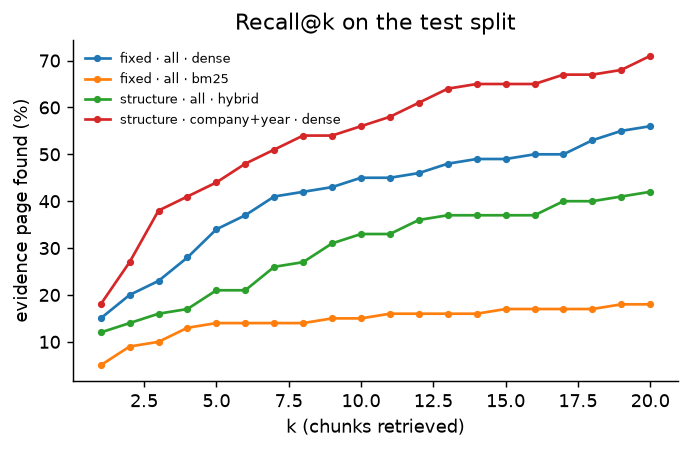

# Financial RAG Lab

A benchmark lab for retrieval-augmented generation over real company filings. Instead of building one RAG pipeline
and hoping it works, it **measures which design choices matter**: chunking, metadata filtering, keyword vs dense vs
hybrid retrieval, cross-encoder reranking and HyDE. Each is scored on whether the *exact evidence page* is retrieved,
and then end to end on answer accuracy.

Data: [FinanceBench](https://github.com/patronus-ai/financebench) (open-source sample): **150 analyst questions over
84 filings** (10-K, 10-Q, 8-K and earnings releases of 32 US companies, 12,013 pages), each with a verified answer and
the page(s) that contain the evidence.

> **Results in one line:** retrieval is the bottleneck. Dense retrieval with company/year filtering beat BM25, hybrid
> and cross-encoder reranking; HyDE lifted evidence recall@5 from 44% to 60% and answer accuracy from 47% to 61%
> (+14 points, 95% CI [+5, +23]); with the evidence pages handed over (oracle) the same model reaches 84%.

## The experiment

| Dimension | Options compared |
|---|---|
| **Chunking** | `fixed` 800-character windows (the usual default) · `page` never crosses a page boundary · `structure` paragraph/table blocks with a "[company \| filing \| year]" header (cheap contextual retrieval) |
| **Scope** | all 84 filings · the company named in the question · company and year |
| **Retriever** | BM25 · dense (bge-small, ONNX) · hybrid (reciprocal rank fusion) · hybrid + MiniLM-L12 cross-encoder · hybrid + bge-reranker-base |
| **Query** | the question · HyDE (embed an LLM-written hypothetical answer) |
| **Generation** | closed book · naive RAG · best configuration · best + HyDE · oracle (the evidence pages themselves) |

Method:
- **Retrieval is scored without an LLM.** A retrieved chunk is a hit when it comes from a FinanceBench evidence page,
  so recall@k and MRR can be computed for all 45 retrieval configurations at no API cost.
- **Dev/test split.** The configuration is chosen on 50 dev questions and reported on the other 100, so picking the
  best of 45 does not inflate the result.
- **Answers are graded by a different model** from the one that wrote them, and the judge is checked: it must accept
  the gold answers and reject gold answers with one number changed by 15%.
- **GraphRAG is deliberately not included.** It needs an LLM pass over every chunk to build its graph, tens of
  thousands of calls for this corpus.

## Results

Test split (100 questions), one run. Answers by `gemini-3.1-flash-lite`, graded by `gemini-3.5-flash-lite` (pinned, no
fallback). Full tables: [`results/RESULTS.md`](results/RESULTS.md).

### Retrieval: is the evidence page in the top k?



| Configuration | Recall@1 | Recall@5 | Recall@10 | MRR |
|---|---|---|---|---|
| Naive: fixed chunks · all filings · dense | 15% | 34% | 45% | 0.23 |
| Chosen on dev: structure · company+year · dense | 18% | 44% | 56% | 0.30 |
| **Chosen on dev + HyDE** | **30%** | **60%** | **79%** | **0.44** |
| Best on test (not selectable): page · company+year · dense | 26% | 53% | 63% | 0.38 |

What each choice is worth (test recall@5, averaged over the other settings of the 45-configuration grid):

| Choice | Options (recall@5) |
|---|---|
| Retriever | dense 42% · hybrid + bge reranker 37% · hybrid + MiniLM reranker 33% · hybrid 19% · BM25 15% |
| Scope | company+year 34% · company 28% · all filings 27% |
| Chunking | structure 32% · page 30% · fixed 27% |
| HyDE (same configuration) | 44% → 60% |

- **Dense beat BM25, hybrid and reranking everywhere.** BM25 is weak here even inside the right filing (its top 5
  contains the evidence page for only 40 of 150 questions): questions use analyst words ("capital expenditure",
  "net PPNE"), statements use line-item wording, and PyMuPDF splits some words ("Cash Flow s"). Fusing a weak BM25
  with dense (RRF) dragged dense down; rerankers re-sort the hybrid top 50, so they recovered only part of the loss
  (hybrid 19% → 37% with the bge reranker, still below dense alone).
- **HyDE works for the same reason BM25 fails:** a hypothetical passage written in filing language ("Purchases of
  property and equipment ...") bridges the vocabulary gap. The passage is written from the question alone, is used
  only for search, and never reaches the answer model.
- **Winner's curse, reported as is.** The configuration chosen on dev (50% dev recall@5) scored 44% on test, while
  `page · company+year · dense` (42% on dev) scored 53% on test. HyDE also shrank from 80% on dev to 60% on test.
  Picking on dev and reporting on test is what exposes this.

### End to end: is the answer right?

Same answer model and the same five-excerpt budget for every variant.

| Variant | Correct | Evidence page in context | Said "NOT FOUND" | Correct when it answered |
|---|---|---|---|---|
| Closed book (no retrieval) | 41% | - | 6 | 41 / 94 (44%) |
| Naive RAG | 24% | 34% | 69 | 21 / 31 (68%) |
| Best config (chosen on dev) | 47% | 44% | 46 | 45 / 54 (83%) |
| **Best config + HyDE** | **61%** | 60% | 21 | 61 / 79 (77%) |
| Oracle (the evidence pages) | 84% | 100% | 5 | 84 / 95 (88%) |

Paired differences (bootstrap over the 100 questions):

| Comparison | Difference | 95% CI |
|---|---|---|
| naive → best | +23 points | [+13, +34] |
| best → best + HyDE | +14 points | [+5, +23] |
| best → oracle | +37 points | [+26, +48] |
| closed book → best | +6 points | [−6, +17] |

- **RAG makes answers trustworthy more than it makes them more frequent.** Closed book answers almost everything and is
  right 44% of the time it answers; the RAG variants say "NOT FOUND" when the evidence is missing and are right
  68–83% of the time they do answer.
- **Naive RAG scores below closed book** (24% vs 41%) because it retrieves the wrong filings and then, correctly,
  refuses. When it does answer it is right 21 times out of 31.
- **Retrieval is the bottleneck:** with the best configuration, answers were right 68% of the time when the evidence
  page was retrieved and 30% when it was not; the oracle reaches 84%.
- **Closed book vs best is not significant** (CI crosses zero). FinanceBench is public and these are large US
  companies, so the model may remember some answers (possible contamination); closed-book scores are an upper bound
  on what memory alone can do.
- A few questions have "there is none" as the gold answer, and "NOT FOUND" was graded correct there (3 for naive,
  2 for best); one of the naive ones is right for the wrong reason (no American Express filing was retrieved at all).

### Can the judge be trusted?

The judge accepted **100%** of the 100 gold answers and rejected **75%** of 85 gold answers with their first number
changed by 15%. It is reliable at accepting correct answers and misses about a quarter of near-miss numbers, so the
reported accuracies may be slightly optimistic for numeric questions.

## Run it

**Windows:** double-click `run.bat`. **macOS:** double-click `run.command`. The first run installs packages, downloads
FinanceBench (~170 MB) and opens the demo, where you can switch chunking, retriever, reranker and scope and see which
pages come back.

```bash
pip install -r requirements.txt
python scripts/setup_data.py                 # questions + 84 filings (CC BY-NC 4.0; downloaded, not redistributed)
python -m lab.run_retrieval                  # retrieval grid, no API key needed (GPU: see requirements.txt)
python -m lab.run_generation hyde            # HyDE passages (API)
python -m lab.run_generation answer          # end-to-end answers + grading (API)
python -m lab.run_generation judge-check     # validate the judge (API)
python -m lab.report                         # results/RESULTS.md + figures/
streamlit run app.py
python -m pytest                             # 11 offline tests
```

## Project layout

```
ragl/
  corpus.py       questions, evidence pages (0-based, verified against the PDFs), page parsing (PyMuPDF), dev/test split
  chunking.py     fixed / page / structure chunkers, each chunk keeps its page provenance
  retrieval.py    BM25, dense, hybrid (RRF), cross-encoder reranking, company/year scope from the question
  generation.py   answer prompt, closed-book prompt, HyDE, judge
  llm.py          Gemini client: two keys, strict model preference, rate limiting, local cache
lab/
  run_retrieval.py    the retrieval grid (first evidence-page rank per question and configuration)
  run_generation.py   HyDE, end-to-end answers, judge check
  report.py           tables and figures
app.py              Streamlit demo
tests/              offline tests
```

## Stack

Python · PyMuPDF · rank-bm25 · fastembed (bge-small-en-v1.5, MiniLM / bge cross-encoders, ONNX) · Gemini
(`google-genai`) · pandas · matplotlib · Streamlit · pytest

## License

Code: MIT. FinanceBench (Islam et al., 2023, Patronus AI) is CC BY-NC 4.0 and is downloaded by the setup script, not
included in this repository.
